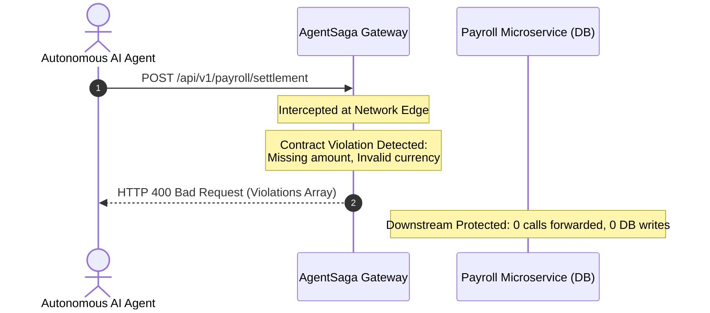
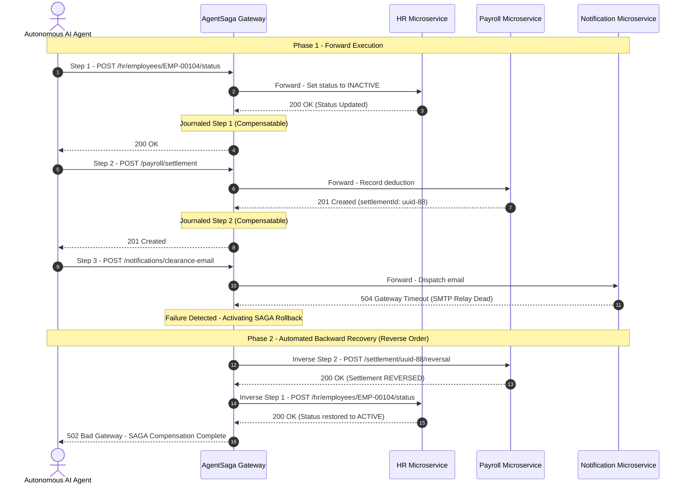

# AgentSaga-Gateway (ASG)

[](https://github.com/Ockersz/agent-saga/actions/workflows/ci.yml)
[](https://opensource.org/licenses/Apache-2.0)
[](https://spec.openapis.org/oas/v3.1.0)
[](#architecture)

**AgentSaga-Gateway** is an open-source, decoupled reverse-proxy and transaction coordinator that enforces **dynamic contract verification** (OpenAPI 3.1) and **SAGA-based compensating rollbacks** for autonomous AI agents executing actions across distributed microservices.

---

## 🎯 The Problem

When autonomous AI agents (powered by frontier LLMs) execute multi-step plans across microservices:
1. **Schema & Semantic Drift:** Agents hallucinate parameters, miss required fields, and introduce type errors that crash downstream services.
2. **Partial Failures & Orphan State:** If an agent successfully reserves an inventory item in Service A, but fails on billing in Service B, standard agent frameworks throw an in-memory exception and crash—leaving databases in an inconsistent, non-recoverable state.
3. **Absence of Zero-Trust Network Mediation:** Existing agent guardrails run client-side in the agent's Python process. In enterprise architectures, downstream microservices cannot trust client-side validation; validation and policy checks must occur at the **network boundary**.

---

## 💡 The Solution: How AgentSaga-Gateway Works

AgentSaga-Gateway sits as a non-blocking reverse proxy between autonomous AI agents and enterprise microservice backends:

```
[ AI Agent Runtime ]
        │
        │ HTTP / Tool Call
        ▼
[ AgentSaga-Gateway ]
   ├── 1. Dynamic OpenAPI Contract Validator (< 5ms)
   ├── 2. Policy & Invariant Gate (Risk Level Evaluation)
   ├── 3. Ephemeral Sandbox Router (Conditional Shadow Dry-Run)
   └── 4. Distributed SAGA State Machine (PostgreSQL Journal)
        │
        ├── (All Valid) ───────────────► [ Downstream Enterprise Microservices ]
        │
        └── (Downstream 500 / Abort) ──► [ SAGA Compensator (Inverse Rollback APIs) ]
```

### Key Architectural Capabilities
* **Dynamic OpenAPI 3.1 Contract Shield:** Validates inbound agent payloads in real time against strict JSON Schema specifications at the network edge before traffic touches downstream databases.
* **Declarative SAGA Extensions (`x-agentsaga-*`):** Annotates standard OpenAPI contracts with compensation paths, risk classifications, and action types (`compensatable`, `pivot`, `retriable`).
* **Automated Backward Recovery:** If an agent workflow aborts or encounters a downstream failure at step $N$, the gateway automatically fires inverse compensating API calls in reverse topological order.
* **Pivot Transaction Isolation:** Enforces strict execution ordering so irreversible side-effects (e.g., physical email dispatch or wire transfers) only execute after all prior compensatable operations have succeeded.

---

## 🎬 Visual Scenarios: AgentSaga in Action

### Scenario 1: Intercepting Schema Drift at the Network Edge (Zero-Trust Shield)
When an autonomous agent generates a malformed payload (missing mandatory fields or hallucinating enum values), AgentSaga-Gateway intercepts and rejects it at the perimeter in **< 2ms**—preventing downstream database corruption.



---

### Scenario 2: Mid-Workflow Crash & Automated SAGA Rollback (The Undo Button)
In an enterprise multi-step workflow (e.g., offboarding: HR $\rightarrow$ Payroll $\rightarrow$ Notification), if the final step crashes with a `504 Gateway Timeout`, standard agent frameworks abort and leave orphan records. AgentSaga-Gateway **automatically triggers reverse-order SAGA compensation** to restore total database consistency.



---

### Scenario 3: The Pivot Transaction Pattern (Irreversible Actions)
Certain actions cannot be programmatically rolled back (e.g., customer emails, physical warehouse dispatch, irreversible wire transfers). AgentSaga enforces execution barriers using the `pivot` action type:

| Action Classification | OpenAPI Extension | Behavior & Safety Invariant |
| :--- | :--- | :--- |
| **Compensatable** | `x-agentsaga-action-type: compensatable` | Executed during forward phase. Paired with explicit `x-agentsaga-compensating-action` inverse endpoint. |
| **Pivot** | `x-agentsaga-action-type: pivot` | **Irreversible terminal action.** Can **only** execute after all preceding compensatable operations have succeeded and committed. If an earlier step fails, the pivot never fires. |
| **Retriable** | `x-agentsaga-action-type: retriable` | Guaranteed idempotent endpoint executed with exponential backoff. |

---

## 📁 Repository Structure

```
├── ARCHITECTURE.md          # Complete Architectural & Data Flow Specification
├── ROADMAP.md               # Engineering Release Milestones & Benchmarking Plan
├── contracts/               # Reference OpenAPI 3.1 Specs with x-agentsaga Extensions
│   ├── hr-service.yaml
│   ├── payroll-service.yaml
│   └── notification-service.yaml
├── gateway/                 # Core Gateway Engine (Reverse Proxy & SAGA Journal)
├── services/                # Reference Enterprise Microservices & Docker Compose Testbed
├── eval-harness/            # Python-based Benchmark & Fault Injection Suite
└── paper/                   # Academic Research Manuscript (IEEE double-column format)
```

---

## 🚀 Quickstart & Documentation

* Read the detailed technical blueprint: [ARCHITECTURE.md](ARCHITECTURE.md)
* View the upcoming development milestones: [ROADMAP.md](ROADMAP.md)
* Inspect reference contract definitions: [contracts/](contracts/)

---

## 📄 License

Licensed under the Apache License, Version 2.0.
